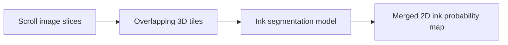

# Ink Detection for Ancient Scrolls

A deep learning research pipeline for detecting ink in volumetric scans of
ancient scrolls, developed as part of a Master's thesis using Vesuvius Challenge
data. Given a stack of image slices around a scroll surface, the model predicts
a two-dimensional map of where ink is likely to be present.

The central question is how to make use of large amounts of **unlabeled scan
data** when manually annotated ink examples are limited. This repository
implements supervised baselines and **Noisy Student training**, an iterative
method that uses model-generated labels to learn from additional data.

## How it works



Each input tile contains both a small surface region and several slices in
depth. The model uses this depth information to predict an ink probability
for each surface pixel. Predictions from overlapping tiles are merged into a
map for the full segment, making it possible to process scans larger than GPU
memory.

Noisy Student training extends this process:

1. Train a **teacher** model on manually labeled segments.
2. Use the teacher to generate **pseudo-labels**: predicted ink maps for
   unlabeled segments. Confidence and uncertainty filters select usable regions.
3. Train a new **student** on manual labels and pseudo-labels, with input
   augmentation and model noise such as dropout.
4. Use the student as the next teacher and repeat. The model can grow between
   iterations, and multiple teacher checkpoints can be combined.

Validation compares predictions with manual annotations using Dice, IoU,
precision, recall, and F-scores. Dice and IoU measure how closely the predicted
ink regions overlap the annotations.

## What the repository includes

- **Training and model comparison:** supervised and Noisy Student workflows,
  an adapted UNETR++ architecture, Vesuvius U-Net and ResNet3D models, and a
  TimeSformer option.
- **Large-volume data handling:** TIFF-to-Zarr conversion, on-demand tile
  loading, configurable sampling, and disk-backed prediction merging.
- **Teacher selection:** individual checkpoints, ensembles, and checkpoint
  weight averaging, with saved teacher selections for resuming experiments.
- **Experiment management:** Hydra configuration, random seeds, mixed
  precision, optional `torch.compile`, W&B logging, and Slurm jobs.
- **Controlled experiments:** ablation profiles for model size, input/model
  noise, and teacher aggregation, including runs across multiple seeds.

The main stack is **Python, PyTorch, MONAI, Hydra, Zarr, and Weights & Biases**.
The model implementations build on existing research and Vesuvius Challenge
code; source acknowledgments are linked below.

## Getting started

### 1. Set up the environment

From the repository root:

```bash
conda env create -f environment.yml
conda activate ink
```

The environment specifies Python 3.12 and installs
[`requirements.txt`](requirements.txt). Training is intended for a CUDA GPU;
the supplied cluster scripts request A100 or A40 GPUs. Memory requirements
depend on the model, tile size, depth, and batch size. The requirements include
a CUDA-specific PyTorch package index; adapt the PyTorch installation to your
machine if needed.

### 2. Configure paths and prepare data

Create a `.env` file at the repository root:

```dotenv
DATA_DIR=/absolute/path/to/data
CODE_DIR=/absolute/path/to/ink_detection
OUTPUT_DIR=/absolute/path/to/outputs
TMP_DIR=/absolute/path/to/scratch
```

Supply scan data and annotations separately; datasets and trained checkpoints
are not bundled with the repository. Follow the [data preparation guide](data/README.md)
to organize TIFF stacks and convert them into `${DATA_DIR}/data_zarr`.

Before training, set `train.labeled`, `train.unlabeled`, and `train.val` in
your configuration to the segment IDs you have prepared. The supplied lists
describe research experiments and must match your local data. For online
experiment logging, run `wandb login`; a fresh offline run can use
`WANDB_MODE=offline`.

### 3. Train a model

Start with a supervised UNETR++ baseline:

```bash
python train.py --config-name=config path=local train=supervised
```

Or run Noisy Student training from scratch:

```bash
python train.py --config-name=config path=local
```

The latter trains a supervised teacher at iteration 0, then generates
pseudo-labels for subsequent student iterations. By default, it runs five
iterations in total (0–4). For other model families, use
`--config-name=config_unet` or `--config-name=config_resnet3d` with their
associated presets.

`path=local` reads prepared Zarr data directly. The default training path
profile targets a cluster and stages tar archives into scratch storage.
Standard local runs save checkpoints and configuration snapshots beneath
`${OUTPUT_DIR}/<training_mode>/<model>/<experiment_name>` and log metrics to W&B.

See the [configuration and training reference](conf/README.md) for CLI
overrides, fixed pseudo-label training, teacher checkpoints, and resuming at
iteration boundaries. For cluster execution, see
[submitting Slurm jobs](slurm_job_scripts/README.md); adapt its cluster-specific
modules, proxy settings, and resource requests to your environment.

### 4. Generate ink predictions

For a checkpoint trained with the default UNETR++ model and dataset settings:

```bash
python predict.py checkpoint=/absolute/path/to/model.pt model=unetrpp_large 'train.segments=["0172_20241025145341"]'
```

Replace the checkpoint and segment ID with your own. Match the model and
dataset configuration to the training run, including any architecture overrides,
tile size, input depth, and normalization. The prediction defaults are in
[`conf/predict.yaml`](conf/predict.yaml).

Prediction exports PNG ink probability, confidence, and uncertainty maps to
`${OUTPUT_DIR}/predict/<model>/<experiment_name>`. Where annotations are
available, it also prints per-segment and aggregate metrics.

## Repository guide

| Location | Purpose |
| --- | --- |
| [`train.py`](train.py), [`predict.py`](predict.py) | Training and inference entry points. |
| [`training/`](training/) | Training loops, checkpoints, precision, and logging. |
| [`models/`](models/) | Model implementations, adapters, and model builder. |
| [`data/`](data/README.md) | Dataset, augmentations, sampling, and preparation tools. |
| [`conf/`](conf/README.md) | Configuration profiles and detailed training reference. |
| [`utils/`](utils/) | Prediction merging, evaluation, pseudo-label refinement, and export. |
| [`slurm_job_scripts/`](slurm_job_scripts/README.md) | Cluster training and preprocessing jobs. |

To explore the experiment design, start with [ablation A](conf/ablation/a/README.md)
for model size and noise, then [ablation B](conf/ablation/b/README.md) for teacher
checkpoint selection and aggregation. Earlier exploratory sweeps are documented
in [pre-ablations](conf/pre_ablations/README.md). The
[ablation plotting utility](utils/ablation/README.md) summarizes validation Dice
from exported W&B logs.

## Acknowledgments and licenses

This project uses Vesuvius Challenge / ScrollPrize data and model code, and
builds on UNETR++. The UNETR++ implementation was adapted from a version used
in an earlier Master's thesis at FAU's Chair for Pattern Recognition and
modified further for this thesis.

See the [Vesuvius model source notes](models/vesuvius_models/README.md) for
upstream references and adaptation details, and [LICENSE](LICENSE) for the
third-party license notices, including MIT and Apache 2.0 terms.
